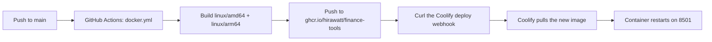

# Deploying on Coolify from the published GHCR image

This is how to run **The Trading Dashboard by Hirawat** on a
[Coolify](https://coolify.io) server without ever building the image there.

The short version: GitHub Actions already builds the multi-architecture image
and publishes it to `ghcr.io/hirawatt/finance-tools`. Point Coolify at that
image as a **Docker Image** resource, and let the workflow tell Coolify when to
pull a new one. The server then only downloads and runs a container — it never
runs `uv`, compiles a wheel, or executes the Dockerfile. That is the whole point
of this document.

## Why not let Coolify build from the Dockerfile

Coolify's **Dockerfile** build pack builds on the same machine that runs the
app. For this project that build resolves `uv.lock` and installs the full
scientific-Python tree (`pandas`, `numpy`, `plotly`, `quantstats`, ...) with
byte-code compilation, in one stage, inside the server's Docker daemon.

| | Coolify builds from `Dockerfile` | Coolify pulls the GHCR image |
| --- | --- | --- |
| Where the build runs | the deployment server | GitHub's runners (free) |
| Peak RAM during deploy | hundreds of MB to ~2 GB, plus CPU for minutes | a few MB, the pull is I/O bound |
| Needs a compiler / uv on the server | yes, via the builder stage | no |
| Needs `pyproject.toml` / `uv.lock` on the server | yes | no |
| Fails on a small VPS | often (swap or OOM-kill during `uv sync`) | no |
| Time to a running container | minutes | seconds to a minute |

On a 1–2 GB VPS the build path is the thing that runs out of memory. Pulling a
prebuilt image removes that entirely.

## How the pipeline fits together



The build, push and deploy-request half already exists in
[`.github/workflows/docker.yml`](.github/workflows/docker.yml), which ends by
asking Coolify to pull the image it just pushed. The piece you create is the
Coolify resource that request targets.

`docker.yml` publishes these tags:

| Tag | Points at | Use for |
| --- | --- | --- |
| `latest`, `main` | the tip of `main` | the default, auto-deploying environment |
| `sha-<commit>` | one specific commit | rollbacks and reproducible deploys |
| `v1.2.3`, `v1.2` | a release tag | pinned production releases |

## Prerequisites

- A running Coolify instance (self-hosted or Coolify Cloud) with a server
  attached.
- The GHCR package `ghcr.io/hirawatt/finance-tools` is **public**, so Coolify
  can pull it anonymously and no registry credentials are needed. Verify from
  any machine:

  ```bash
  docker pull ghcr.io/hirawatt/finance-tools:latest
  ```

  If that fails with `unauthorized`, the package was flipped to private — see
  [Private packages](#private-packages) below.
- Optional: a domain whose DNS points at the Coolify server.

## 1. Create a Docker Image resource

In Coolify, open a project and environment, select **+ New**, and choose
**Docker Image** — not *Public Repository*, *Deploy Key* or *Dockerfile*. This
choice is what keeps the build off the server.

| Field | Value |
| --- | --- |
| Image Name | `ghcr.io/hirawatt/finance-tools` |
| Tag (optional) | `latest` |

You can paste the full reference `ghcr.io/hirawatt/finance-tools:latest` into
the image field and Coolify splits the tag out for you. Select **Save**.

Coolify's Docker Image resource deliberately ignores Git sources, deploy keys
and every build pack; the image supplies the filesystem and the default process,
and Coolify only manages the runtime around it.

## 2. Configure the runtime

Open **General** and set the following. None of these change the image, they are
applied when Coolify starts the container.

### Port

**Ports Exposes** defaults to `80`, which is wrong for this app. Set it to
`8501`, the port Streamlit listens on inside the container (the Dockerfile sets
`STREAMLIT_SERVER_PORT=8501` and `EXPOSE 8501`). Coolify's proxy routes the
domain to this port.

### Health check

The image already declares a `HEALTHCHECK`, but Coolify's own health check is
what enables zero-downtime replacement:

| Field | Value |
| --- | --- |
| Health check | enabled |
| Path | `/_stcore/health` |
| Port | `8501` |

Streamlit answers `ok` on that path with no auth, which is exactly what a probe
wants.

### Persistent storage

Watchlists a user creates in the app are written to `/app/indices` inside the
container, and the image ships the committed `indices/` there. Without a volume
they are lost on every redeploy.

Under **Persistent Storage**, add these volumes:

| Name | Destination | Holds |
| --- | --- | --- |
| `indices` | `/app/indices` | watchlists created in the Index Creator |
| `portfolios` | `/app/portfolios` | portfolios saved from the Import page |
| `profiles` | `/app/profiles` | saved column mappings for imports |

`indices/` is committed to the repository and so ships inside the image;
`portfolios/` and `profiles/` are created at runtime and are never baked in, so
without a volume they are lost on every redeploy.

The process runs as the unprivileged `app` user (uid 1000) created in the
Dockerfile; Coolify's volume is owned by root by default, so if the app cannot
write, set the mount's permissions or chown the host path to uid 1000.

### Resource limits

Under **Resource Limits** cap the container so a runaway session cannot take
down the host. Streamlit plus a portfolio load of pandas work is comfortable in
roughly:

| Resource | Suggestion |
| --- | --- |
| Memory | 512 MB minimum, 1–2 GB if several users analyze large portfolios |
| CPU | 1–2 cores |

This limit only shapes the running container. It is not a build budget, because
there is no build.

### Environment variables

The container image already bakes in sensible Streamlit defaults
(`STREAMLIT_SERVER_PORT`, `STREAMLIT_SERVER_ADDRESS=0.0.0.0`,
`STREAMLIT_SERVER_HEADLESS`, no file watcher, no usage stats), so you only add
what is environment-specific.

The one group worth setting is snapshot storage. With no `SNAPSHOT_*` values the
Co-Pilot falls back to live Yahoo/NSE fetches on each cold load; pointing it at
the nightly snapshot makes those reads instant (see the README's
[Nightly Market-Data Snapshot](README.md#nightly-market-data-snapshot) section).

| Variable | Purpose |
| --- | --- |
| `SNAPSHOT_BUCKET` | S3 bucket holding the nightly Parquet snapshot |
| `SNAPSHOT_PREFIX` | key prefix inside the bucket (default `snapshots`) |
| `SNAPSHOT_ENDPOINT_URL` | S3-compatible endpoint, e.g. Cloudflare R2 |
| `SNAPSHOT_REGION` | region, or `auto` for R2 |
| `SNAPSHOT_ACCESS_KEY` | access key id |
| `SNAPSHOT_SECRET_KEY` | secret key |

Add these under **Environment Variables** and mark the two credentials as
secret. Do not commit them, and do not bake them into the image: the Dockerfile
and `.dockerignore` deliberately keep `.streamlit/secrets.toml` out of the
image, so Coolify's environment is the right place for them.

If you would rather mount a secrets file, add a volume from a host file to
`/app/.streamlit/secrets.toml` (read-only) and use the `[snapshot]` table shape
from [`.streamlit/example.secrets.toml`](.streamlit/example.secrets.toml).

### Domain

Under **General > Domains**, add your domain. Coolify issues the certificate and
reverse-proxies to port 8501. A domain is optional; without one you can still
reach the app on the server's IP and port.

## 3. Wire the automatic deploy (CI/CD)

A Docker Image resource has no Git webhook, so Coolify is triggered by an
authenticated request from GitHub Actions after the image is published.

### 3a. Enable the Coolify API and create a token

On a self-hosted instance:

1. **Settings > Advanced**, set **API access** to **Enabled**, and save.
2. **Keys & Tokens > API Tokens**, create a token with the **Deploy**
   permission, and copy it — it is shown once.

Coolify Cloud has API access on by default.

### 3b. Copy the deploy webhook URL

Open the application, go to **Webhooks**, and copy the **Deploy webhook URL**.
It already identifies this application.

### 3c. Add the repository secrets

In the GitHub repository: **Settings > Secrets and variables > Actions**, add

| Secret | Value |
| --- | --- |
| `COOLIFY_WEBHOOK` | the deploy webhook URL from step 3b |
| `COOLIFY_TOKEN` | the API token from step 3a |

### 3d. The workflow step (already in the repo)

[`.github/workflows/docker.yml`](.github/workflows/docker.yml) already ends the
`publish` job with this step, **after** `Build and push` so Coolify only ever
pulls an image that finished uploading:

```yaml
      - name: Trigger Coolify deployment
        if: github.event_name != 'pull_request'
        env:
          COOLIFY_WEBHOOK: ${{ secrets.COOLIFY_WEBHOOK }}
          COOLIFY_TOKEN: ${{ secrets.COOLIFY_TOKEN }}
        run: |
          if [ -z "$COOLIFY_WEBHOOK" ]; then
            echo "COOLIFY_WEBHOOK is not set; skipping Coolify deploy."
            exit 0
          fi
          curl --fail --silent --show-error \
            --request POST "$COOLIFY_WEBHOOK" \
            --header "Authorization: Bearer $COOLIFY_TOKEN"
```

It is a no-op on pull requests (nothing is pushed) and when `COOLIFY_WEBHOOK` is
unset, so the workflow stays green before the secrets exist. Order matters: if
the request ran before the push, Coolify would pull the previous `latest` while
CI is still uploading the new one, and you would silently deploy stale code.

If you would rather isolate the trigger from the build, Appendix B has a
standalone workflow that fires only once the Docker workflow has finished
successfully.

If your Coolify webhook URL already carries its own token query parameter, the
`Authorization` header is redundant and can be dropped.

## 4. First deploy and verification

1. In Coolify, select **Deploy** and watch **Deployment Logs**. You should see
   Coolify pull the image — and no build, no `uv`, no `docker build`.
2. Confirm the container starts and the health check passes.
3. Poll the app:

   ```bash
   curl -fsS https://<your-domain>/_stcore/health   # -> ok
   ```
4. Push a trivial commit to `main`, let the Docker workflow finish, and confirm
   a new Coolify deployment appears on its own.

## 5. Rollback

Two options, both cheap because nothing needs rebuilding:

- **Coolify rollback:** open the application's deployment history and roll back
  to the previous deployment. Coolify keeps the previous image on the server.
- **Pin a tag:** set **General > Docker Registry > Docker Image Tag or Hash** to
  `sha-<the-good-commit>` and redeploy, then move back to `latest` once the fix
  is on `main`.

For production, pinning to a `sha-` tag or a digest is the safest habit: `latest`
is mutable, and a restart re-pulls whatever `latest` currently points at.

## Appendix A: sizing at a glance

The server footprint after this change is just Docker plus the running
container. There is no builder stage, no uv cache and no compiler in the image,
because the runtime stage of the Dockerfile copies only the finished virtualenv.

## Appendix B: standalone deploy workflow

Use this if you prefer to leave `docker.yml` untouched. It runs after the
**Docker image** workflow completes successfully on `main`, so the image is
guaranteed to be published before Coolify is asked to pull it.

Create `.github/workflows/coolify-deploy.yml`:

```yaml
name: Deploy to Coolify

on:
  workflow_run:
    workflows: ["Docker image"]
    types: [completed]
    branches: ["main"]
  workflow_dispatch:

permissions:
  contents: read

jobs:
  deploy:
    name: Trigger Coolify
    runs-on: ubuntu-latest
    if: github.event_name == 'workflow_dispatch' || github.event.workflow_run.conclusion == 'success'
    steps:
      - name: Trigger Coolify deployment
        env:
          COOLIFY_WEBHOOK: ${{ secrets.COOLIFY_WEBHOOK }}
          COOLIFY_TOKEN: ${{ secrets.COOLIFY_TOKEN }}
        run: |
          if [ -z "$COOLIFY_WEBHOOK" ]; then
            echo "COOLIFY_WEBHOOK is not set; skipping Coolify deploy."
            exit 0
          fi
          curl --fail --silent --show-error \
            --request POST "$COOLIFY_WEBHOOK" \
            --header "Authorization: Bearer $COOLIFY_TOKEN"
```

## Appendix C: private packages

The package is public today, so skip this. If it is ever made private, every
deployment server must authenticate to pull it.

1. Create a GitHub token with at least `read:packages`.
2. Log in as the server user Coolify runs as (the `coolify-helper` container
   reads `/root/.docker/config.json` on the host):

   ```bash
   echo "$GH_TOKEN" | docker login ghcr.io --username <github-user> --password-stdin
   ```

3. Alternatively, create a [Docker registry credential](https://coolify.io/docs/applications/builds/docker-registries)
   in Coolify and attach it to the resource.

A symptom of getting this wrong is `unauthorized` / `denied` during the Coolify
pull while `docker pull` on the host itself succeeds.

## Troubleshooting

| Symptom | Cause and fix |
| --- | --- |
| Coolify log shows `uv sync` or a Dockerfile build | the resource is the wrong type; delete it and create a **Docker Image** resource |
| Pull fails with `unauthorized` | the package went private; make it public again or [authenticate the server](#appendix-c-private-packages) |
| Deploy succeeds but the app is unchanged | a mutable `latest` was not re-pulled, or the webhook never fired; check the GitHub Actions run and redeploy |
| `502` / timeout on the domain | **Ports Exposes** is still `80`; set it to `8501` |
| Health check never passes | path must be `/_stcore/health` on port `8501` |
| Watchlists, portfolios or mappings disappear on redeploy | no volume mounted at `/app/indices`, `/app/portfolios` or `/app/profiles`, or the app user cannot write to it |
| Container OOM-killed at runtime | raise the **Resource Limits** memory cap; this is the running app, not a build |

## Related

- [`Dockerfile`](Dockerfile) — still how the image is built, in CI and locally.
- [`.github/workflows/docker.yml`](.github/workflows/docker.yml) — builds and
  publishes the image.
- [README](README.md#run-with-docker) — running the image locally with Docker.
