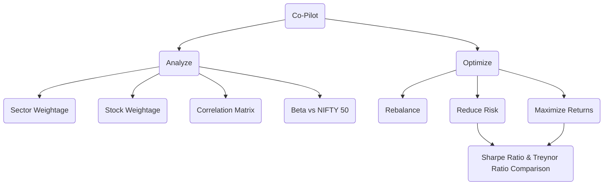

# Portfolio Analyzer

## 📊 Portfolio Analytics

Below the allocation charts, the **Portfolio Analytics** section pulls daily price
history (Yahoo Finance) for your holdings and the NIFTY 50 benchmark:

- **Correlation** — a heatmap of how your holdings move together, plus the most
  correlated pairs, to spot concentration risk.
- **Beta & Risk** — each holding's beta versus NIFTY 50, with a value-weighted
  risk/return summary for the whole portfolio.
- **Valuation** — trailing/forward P/E, P/B, EPS and market cap per holding,
  with the portfolio's value-weighted P/E (total value ÷ total earnings).
- **Rebalance** — target allocations (equal weight, inverse volatility, risk
  parity) with an optional per-holding cap, shown against your current mix as a
  buy/sell trade list in shares and rupees.
- **Tearsheet** — the full [quantstats](https://github.com/ranaroussi/quantstats)
  metrics table (Sharpe, Sortino, Calmar, drawdown, etc.).

You can change the lookback period; symbols without enough history are skipped
automatically.
