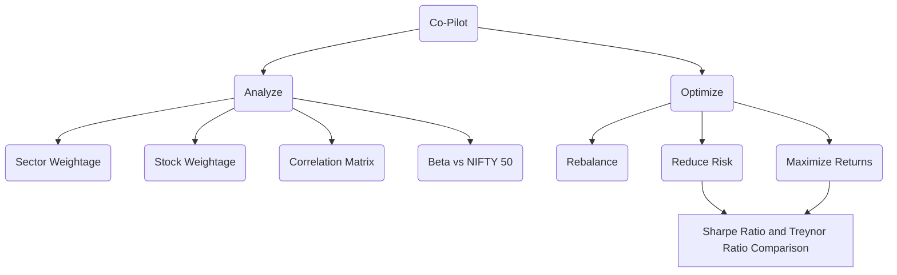

# Portfolio Analyzer

## Bringing your portfolio in

Open **Import Portfolio**, drop the holdings statement from your broker, and the
page reads it, matches every holding to an NSE symbol and shows a preview before
you commit.

- **Zerodha** — Console → Portfolio → Holdings → download the XLSX. The five
  quantity buckets (available, long-term, pledged) are summed for you.
- **Groww** — Stocks → Holdings → download the statement.
- **Dhan** — Portfolio → Holdings → export the CSV/XLSX.
- **Angel One** — Portfolio → Holdings → download the statement.
- **Anything else** — drop the sheet, pick *Generic*, and point each field at the
  column it lives in; the mapping can be saved and reused.
- **Every broker at once** — drop a **CAS** PDF (Consolidated Account Statement
  from [CDSL](https://www.cdslindia.com/) or [NSDL](https://nsdl.co.in/)) and
  enter its password (usually PAN + date of birth). One statement covers every
  demat account and broker. A CAS has no purchase price, so invested value and
  P&L read flat — positions and weights are still exact.

Symbols are matched by **ISIN** first (the same key at every broker), then by the
trading symbol, then by company name. Rows that cannot be matched are listed —
never silently dropped — so you can fix them.

**Privacy.** Your file is read in memory for the session and is not uploaded
anywhere. *Use this portfolio* analyses it without touching disk; *Save locally*
is the only action that writes, and it writes to the git-ignored `portfolios/`
directory on this machine. A PocketBase backend with auth is the intended home
for a book of clients later.

Once you have saved portfolios, the Co-Pilot's sidebar **Portfolio** picker
switches between them — the sample, any saved client, and the file you imported
this session — so a book of clients is one dropdown away.

## Portfolio Analytics

Below the allocation charts, the **Portfolio Analytics** sections pull data for your
holdings from Yahoo Finance and NSE:

- **Correlation** — a heatmap of how your holdings move together, plus the most
  correlated pairs, to spot concentration risk.
- **Beta & Risk** — each holding's beta versus NIFTY 50, with a value-weighted
  risk/return summary for the whole portfolio.
- **Valuation** — trailing/forward P/E, P/B, EPS and market cap per holding,
  with the portfolio's value-weighted P/E (total value ÷ total earnings).
- **Risk Flags** — a rule-based screen over reported fundamentals (leverage,
  earnings, cash flow, margins, valuation); Altman Z-score default-risk zones;
  and NSE ASM/GSM surveillance-list membership.
- **Rebalance** — target allocations (equal weight, inverse volatility, risk
  parity) with an optional per-holding cap, shown against your current mix as a
  buy/sell trade list in shares and rupees.
- **Outlook** — upcoming earnings dates and a Monte Carlo projection of the
  portfolio value (a scenario range, not a prediction).
- **Tearsheet** — the full [quantstats](https://github.com/ranaroussi/quantstats)
  metrics table (Sharpe, Sortino, Calmar, drawdown, etc.).

You can change the lookback period; symbols without enough history are skipped
automatically.
