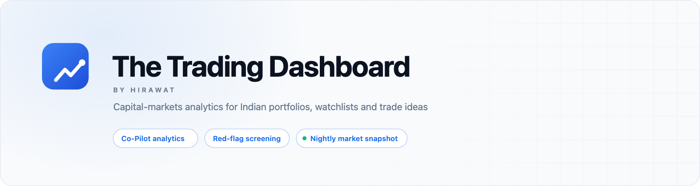
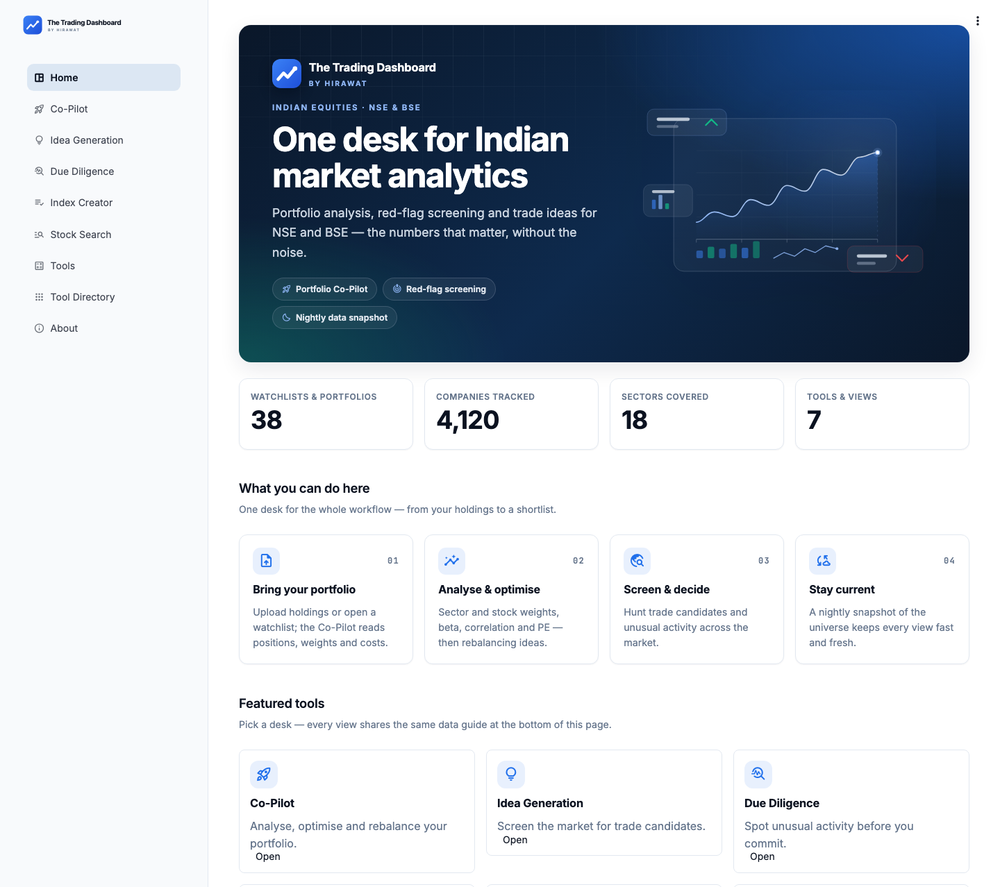

**The Trading Dashboard by Hirawat** (`finance-tools`) is a
Streamlit app for Indian capital-markets analysis: portfolio analytics,
trade-idea screening and watchlist tooling over NSE/BSE data — the numbers that
matter, without the noise.

[](https://finance-tools.streamlit.app/)
[](https://opensource.org/licenses/MIT)
[](https://github.com/sponsors/hirawatt)
[](https://www.python.org/downloads/)
[](https://github.com/hirawatt/finance-tools)

## What it looks like



The home page opens with the app's mark and name, the headline counts behind it
(watchlists, companies, sectors), a four-step **what you can do here** strip —
bring your portfolio, analyse and optimise, screen and decide, stay current —
and a card per tool. Every other page opens with the same header, a one-line
subtitle and an accent rule, and closes with the shared footer.

## Featured Tools

### 1. Zerodha Leaderboards

Track top performers using [Verified PnL](https://support.zerodha.com/category/console/reports/other-queries/articles/verified-p-l)
**Live Demo**: [zerodha.hirawat.in](https://zerodha.hirawat.in/)

### 2. Co-Pilot: Portfolio Analyzer

An intelligent portfolio management system that provides comprehensive analysis and optimization suggestions for your investments.

#### Key Features

- Portfolio Analysis
- Risk Assessment
- Performance Tracking
- Rebalancing Suggestions
- Risk Management

## Getting Started

```bash
# Clone the repository
git clone https://github.com/hirawatt/finance-tools.git
cd finance-tools

# Install uv if you don't have it (https://docs.astral.sh/uv/)
brew install uv

# Create the environment (interpreter pinned in .python-version, deps from uv.lock)
uv sync

# Run the Streamlit app
uv run streamlit run main.py
```

`requirements.txt` is generated from `uv.lock` (`uv export`) for Streamlit
Community Cloud, which cannot read the lockfile; don't edit it by hand.

## App Structure

`main.py` is the entrypoint: it sets the page configuration once and registers
every page with [`st.navigation`](https://docs.streamlit.io/develop/api-reference/navigation/st.navigation)
and [`st.Page`](https://docs.streamlit.io/develop/api-reference/navigation/st.page),
so the sidebar's titles, icons and order all live in one place.

| Page | Module | Purpose |
| --- | --- | --- |
| Home | `main.py` | Branded landing page: hero, headline stats, workflow strip, tool cards and the data guide |
| Import Portfolio | `pages/portfolio_import.py` | Bring holdings from a broker, resolve symbols, keep them session-only or save locally |
| Co-Pilot | `pages/portfolio_analysis.py` | Portfolio analytics, risk and rebalancing |
| Idea Generation | `pages/stocks_to_trade.py` | Candidate trade ideas |
| Due Diligence | `pages/surprises.py` | Surprise and unusual-activity checks |
| Index Creator | `pages/index_creator.py` | Build, edit and export watchlists |
| Stock Search | `pages/stock_search.py` | Small-cap stock screener |
| Tools | `pages/tools.py` | Percentage up/down calculator |
| Tool Directory | `pages/tool_directory.py` | Linked logo grid of external Indian-market platforms |
| About | `pages/about.py` | Credits and links |

Page modules use plain `snake_case` names (no ordering numbers or emoji
prefixes) and must not call `st.set_page_config` — the entrypoint owns the
page configuration. Pure, testable analytics helpers live in `utils/`.

## Design & theme

The look is a light "trading terminal" in the vein of Zerodha Kite, Dhan and
Screener.in: a white canvas, one confident blue accent, and numbers that read
at a glance.

- **Colours, fonts and radii** live in [`.streamlit/config.toml`](.streamlit/config.toml)
  — Inter for the interface, JetBrains Mono for code and tickers, plus
  categorical/sequential/diverging chart palettes that keep multi-series plots
  legible. Restart the app after editing it.
- **Gaps Streamlit cannot theme** (the home hero, the workflow strip, carded
  metrics/tables/charts, the sidebar rail, the footer) live in
  [`utils/theme.py`](utils/theme.py) as one stylesheet plus small helpers —
  `apply_theme`, `hero`, `steps`, `page_header`, `section_header`, `metric_row`,
  `card`, `feature_card`, `glyph`, `footer`.
  It is injected with `st.html`, so a page's markdown elements stay exactly as
  the page wrote them. Keep angle brackets out of that stylesheet: Streamlit
  drops a style-only `st.html` payload whose text contains a tag-like sequence,
  which would silently strip the whole theme
  ([`tests/test_style.py`](tests/test_style.py) guards it).
- **No emoji, anywhere.** Iconography is [Material Symbols](https://fonts.google.com/icons),
  the font Streamlit already bundles: `:material/<name>:` where a page is
  registered in `main.py` (and for widget `icon=` arguments), and
  `theme.glyph("<name>")` inside custom HTML. [`tests/test_style.py`](tests/test_style.py)
  fails the build if an emoji creeps back in.
- **Brand marks are committed files** in `assets/` — the browser-tab icon
  `favicon.svg`, the high-resolution `app-icon.svg` (the hero lockup and the
  app's square mark), `logo.svg` (the sidebar lockup), `hero-graphic.svg` (the
  home hero illustration), `banner.svg` with its rendered `banner.png` (the
  README header), `social-card.svg` (link previews) and the tool-directory
  logos in `assets/logos/` (see that folder's README for provenance) — so the
  app never fetches a mark at runtime and the container image needs no network
  for its own chrome. `assets/screenshots/` holds the README's app capture; see
  [`assets/README.md`](assets/README.md) for what each file is and how the
  raster ones are regenerated.

When adding a page, register it in `main.py` with a title and a
`:material/icon_name:` icon, and open the content with `theme.page_header(...)`
so the heading, subtitle and accent rule stay consistent.

## Run with Docker

Every push to `main` publishes a multi-architecture image (`linux/amd64` and
`linux/arm64`) to the GitHub Container Registry, so the dashboard runs without a
clone or a Python install:

```bash
docker run --rm -p 8501:8501 ghcr.io/hirawatt/finance-tools:latest
# then open http://localhost:8501
```

| Tag | Points at |
| --- | --- |
| `latest`, `main` | the tip of `main` |
| `sha-<commit>` | one specific commit |
| `v1.2.3`, `v1.2` | a release tag |

The image is self-contained: the interpreter (3.15) and every dependency come
from `uv.lock`, and with no snapshot storage configured the Co-Pilot falls back
to live Yahoo/NSE fetches. To read your own snapshot bucket, pass the
`SNAPSHOT_*` variables:

```bash
docker run --rm -p 8501:8501 \
  -e SNAPSHOT_BUCKET=my-bucket \
  -e SNAPSHOT_ENDPOINT_URL=https://<account-id>.r2.cloudflarestorage.com \
  -e SNAPSHOT_ACCESS_KEY=... -e SNAPSHOT_SECRET_KEY=... \
  ghcr.io/hirawatt/finance-tools:latest
```

Or mount a secrets file to also override the About-page credits:

```bash
docker run --rm -p 8501:8501 \
  -v "$PWD/.streamlit/secrets.toml:/app/.streamlit/secrets.toml:ro" \
  ghcr.io/hirawatt/finance-tools:latest
```

Build it locally with `docker build -t finance-tools .`.

Watchlists you create in the app are written to `/app/indices` inside the
container, so mount that directory to keep them across restarts:

```bash
docker run --rm -p 8501:8501 -v "$PWD/indices:/app/indices" ghcr.io/hirawatt/finance-tools:latest
```

Portfolios saved from the Import page and saved column mappings go to
`/app/portfolios` and `/app/profiles`; mount those too if you want them to
survive a restart. Neither is ever baked into the image.

To run this image on a server that redeploys automatically on every push to
`main`, see [Deploying on Coolify](DEPLOY.md) — it deploys the published image
instead of building it on the host.

## Roadmap

### Portfolio Analyzer

- [x] Import holdings from a broker — Zerodha, Groww, Dhan and Angel One are detected from the file's headers; any other sheet maps through the generic column editor
- [x] ISIN-first symbol resolution, so the same stock imported from two brokers merges into one position
- [x] Integration with [quantstats](https://github.com/ranaroussi/quantstats)
- [x] Advanced Portfolio Analytics
  - [x] Sector & Stock Weightage
  - [x] Portfolio Beta Calculation
  - [x] PE Ratio Analysis
  - [x] Correlation Matrix
- [x] Risk Management
  - [x] ASM/GSM List Monitoring
  - [x] Default Probability Assessment
  - [x] Automated Rebalancing Suggestions
- [x] Market Intelligence
  - [x] Earnings Calendar
  - [x] Price Forecasting
  - [x] Red Flag Detection

### Platform

- [x] Nightly market-data snapshot on S3-compatible storage
- [x] Dependency management with [uv](https://docs.astral.sh/uv/)
- [x] Multi-arch container image published to [GHCR](https://ghcr.io/hirawatt/finance-tools)
- [x] Streamlit-native multipage navigation with `st.navigation` / `st.Page`
- [x] Shared trading-terminal theme (brand palette, Inter/JetBrains Mono, carded metrics and tables)
- [x] Modern Streamlit UI pass (segmented controls, pill filters, responsive control rows, sparkline metrics, `column_config` tables, accessible charts)
- [x] Tool Directory: a linked logo grid of the external platforms used around the dashboard
- [x] Privacy-first portfolio storage: session-only by default, with an opt-in local `portfolios/` backend behind a `PortfolioStore` seam (PocketBase-ready for a later client book)
- [x] Branded home page: app mark and name, an illustrated hero, a four-step workflow strip, headline stats and the tool cards, with a README screenshot
- [x] Fix: the theme stylesheet was silently dropped by Streamlit's sanitiser (a tag-like sequence in a CSS comment), leaving every page unstyled

## Portfolio Analysis Flow


## Nightly Market-Data Snapshot

The Co-Pilot's analytics would otherwise fetch every holding from Yahoo and NSE
on each cold load — roughly 60 upstream requests for a 15-stock portfolio. A
scheduled job instead fetches the curated universe once a night and publishes
Parquet files plus a manifest to S3-compatible storage; the app reads that
snapshot, and only falls back to a live fetch for symbols it does not cover
(so an arbitrary uploaded portfolio still works).

**Build it locally:**

```bash
uv run python scripts/build_snapshot.py --local ./snapshots   # local directory
uv run python scripts/build_snapshot.py --limit 5             # smoke run
```

With no `SNAPSHOT_*` configuration the snapshot is written to `./snapshots`
(git-ignored) and the app reads it when run on the same machine.

**Configure object storage** — any S3-compatible endpoint (AWS S3, Cloudflare
R2, MinIO, Backblaze B2). For the app, add a `[snapshot]` table to
`.streamlit/secrets.toml` (see `.streamlit/example.secrets.toml`); for the
nightly job, add the same values as repository secrets named `SNAPSHOT_BUCKET`,
`SNAPSHOT_PREFIX`, `SNAPSHOT_ENDPOINT_URL`, `SNAPSHOT_REGION`,
`SNAPSHOT_ACCESS_KEY` and `SNAPSHOT_SECRET_KEY`.

[`.github/workflows/nightly-snapshot.yml`](.github/workflows/nightly-snapshot.yml)
runs the job nightly at 01:00 IST (and on demand). The universe is every
watchlist in `indices/` plus the sample portfolio — currently ~220 symbols;
edit `utils/snapshot.py::build_universe` to widen it.

## Contributing

Contributions are welcome! Please feel free to submit a Pull Request.

## Support the Project

If you find this project useful, consider supporting its development:

- [GitHub Sponsors](https://github.com/sponsors/hirawatt)
- <a href="https://www.buymeacoffee.com/hirawat" target="_blank"></a>

## License

This project is licensed under the MIT License - see the [LICENSE](LICENSE) file for details.
