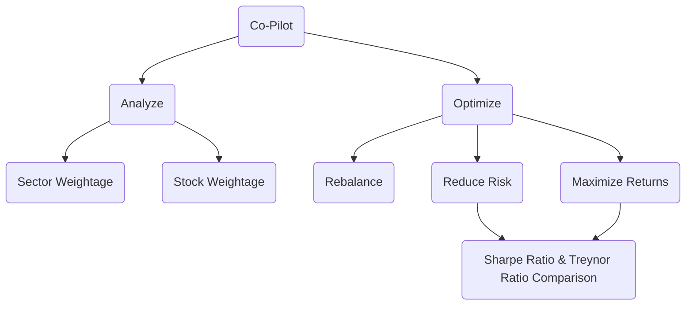

# Finance-Tools 📊

A collection of financial analysis tools to help investors make data-driven decisions.

[](https://finance-tools.streamlit.app/)
[](https://opensource.org/licenses/MIT)
[](https://github.com/sponsors/hirawatt)
[](https://www.python.org/downloads/)
[](https://github.com/hirawatt/finance-tools)

## 🌟 Featured Tools

### 1. Zerodha Leaderboards

Track top performers using [Verified PnL](https://support.zerodha.com/category/console/reports/other-queries/articles/verified-p-l)
📈 **Live Demo**: [zerodha.hirawat.in](https://zerodha.hirawat.in/)

### 2. Co-Pilot: Portfolio Analyzer

An intelligent portfolio management system that provides comprehensive analysis and optimization suggestions for your investments.

#### Key Features

- 📊 Portfolio Analysis
- 🎯 Risk Assessment
- 📈 Performance Tracking
- 🔄 Rebalancing Suggestions
- 📉 Risk Management

## 🚀 Getting Started

```bash
# Clone the repository
git clone https://github.com/hirawatt/finance-tools.git
cd finance-tools

# Install uv if you don't have it (https://docs.astral.sh/uv/)
brew install uv

# Create the environment (interpreter pinned in .python-version, deps from uv.lock)
uv sync

# Run the Streamlit app
uv run streamlit run main.py
```

`requirements.txt` is generated from `uv.lock` (`uv export`) for Streamlit
Community Cloud, which cannot read the lockfile; don't edit it by hand.

## 🗺️ Roadmap

### Portfolio Analyzer

- [x] Integration with [quantstats](https://github.com/ranaroussi/quantstats)
- [x] Advanced Portfolio Analytics
  - [x] Sector & Stock Weightage
  - [x] Portfolio Beta Calculation
  - [x] PE Ratio Analysis
  - [x] Correlation Matrix
- [x] Risk Management
  - [x] ASM/GSM List Monitoring
  - [x] Default Probability Assessment
  - [x] Automated Rebalancing Suggestions
- [x] Market Intelligence
  - [x] Earnings Calendar
  - [x] Price Forecasting
  - [x] Red Flag Detection 🚩

### Platform

- [x] Nightly market-data snapshot on S3-compatible storage
- [x] Dependency management with [uv](https://docs.astral.sh/uv/)

## 📊 Portfolio Analysis Flow



## 🗓️ Nightly Market-Data Snapshot

The Co-Pilot's analytics would otherwise fetch every holding from Yahoo and NSE
on each cold load — roughly 60 upstream requests for a 15-stock portfolio. A
scheduled job instead fetches the curated universe once a night and publishes
Parquet files plus a manifest to S3-compatible storage; the app reads that
snapshot, and only falls back to a live fetch for symbols it does not cover
(so an arbitrary uploaded portfolio still works).

**Build it locally:**

```bash
uv run python scripts/build_snapshot.py --local ./snapshots   # local directory
uv run python scripts/build_snapshot.py --limit 5             # smoke run
```

With no `SNAPSHOT_*` configuration the snapshot is written to `./snapshots`
(git-ignored) and the app reads it when run on the same machine.

**Configure object storage** — any S3-compatible endpoint (AWS S3, Cloudflare
R2, MinIO, Backblaze B2). For the app, add a `[snapshot]` table to
`.streamlit/secrets.toml` (see `.streamlit/example.secrets.toml`); for the
nightly job, add the same values as repository secrets named `SNAPSHOT_BUCKET`,
`SNAPSHOT_PREFIX`, `SNAPSHOT_ENDPOINT_URL`, `SNAPSHOT_REGION`,
`SNAPSHOT_ACCESS_KEY` and `SNAPSHOT_SECRET_KEY`.

[`.github/workflows/nightly-snapshot.yml`](.github/workflows/nightly-snapshot.yml)
runs the job nightly at 01:00 IST (and on demand). The universe is every
watchlist in `indices/` plus the sample portfolio — currently ~220 symbols;
edit `utils/snapshot.py::build_universe` to widen it.

## 🤝 Contributing

Contributions are welcome! Please feel free to submit a Pull Request.

## 💝 Support the Project

If you find this project useful, consider supporting its development:

- [GitHub Sponsors](https://github.com/sponsors/hirawatt)
- <a href="https://www.buymeacoffee.com/hirawat" target="_blank"></a>

## 📝 License

This project is licensed under the MIT License - see the [LICENSE](LICENSE) file for details.
